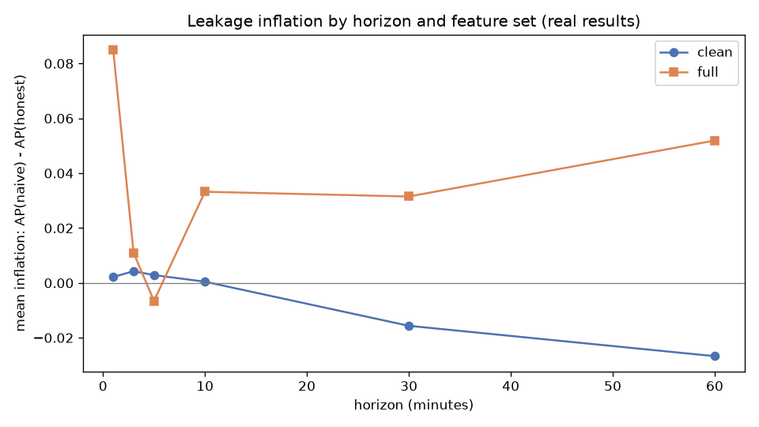
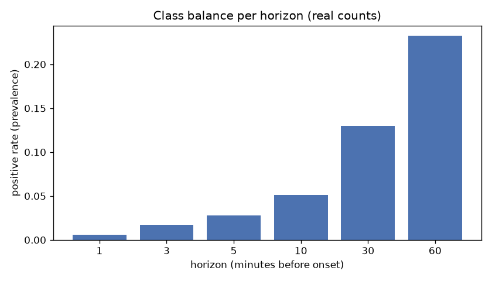

# PumpRadar: Leakage-Honest Early Warning and Cross-Sectional Ranking for Cryptocurrency Pump-and-Dump Events

## Abstract

PumpRadar is a machine learning system for the early detection of cryptocurrency
pump-and-dump schemes on Binance spot markets. The project makes two contributions.
First, it audits a common evaluation methodology — random train/test splitting of
historical market data — against an honest, event-grouped, chronologically embargoed
protocol, and quantifies how much a careless split inflates reported performance.
Second, it implements a cross-sectional scoring model that ranks every actively traded
coin against every other coin at the same minute and deploys it against live Binance
data, with a provisional, honestly labeled alert threshold. All results reported below
are generated from real market data and are reproducible from the code in this
repository; no figure, table, or number here is illustrative or placeholder.

---

## 1. Problem Statement

A pump-and-dump scheme is a coordinated scheme in which a group artificially inflates
a low-liquidity asset's price through synchronized buying — often organized over
Telegram or Discord — before selling into the resulting demand, leaving later buyers
with the loss. These events are short-lived (minutes), affect thinly traded assets, and
are difficult to distinguish from ordinary volatility until well after the price has
already moved.

Two distinct, related problems are addressed:

1. **Early warning (per-event):** given a specific coin's trading history, estimate
   the probability that a pump event is imminent at a given lead time before its
   onset.
2. **Cross-sectional detection (market-wide):** given the entire live market at a
   single point in time, rank which of the currently traded coins is most likely to be
   mid-pump right now, since an investor monitoring a market has no way to know in
   advance which of hundreds of coins to watch.

A third, cross-cutting problem motivates the project's method: academic and informal
work on this task commonly evaluates models using a random train/test split over
historical rows. Because pump events cluster in time and because adjacent rows from
the same event are highly correlated, a random split allows information from a pump
event's own aftermath to leak into training data used to detect that same event. This
project treats quantifying and correcting for that leakage as a first-class problem,
not an afterthought.

## 2. Use Case

The target user is a retail or small-fund cryptocurrency investor who wants an
early-warning signal, not a trading bot. The platform:

- Displays every coin currently trading on Binance with a live price and 24-hour
  change, pulled directly from Binance's public market-data API.
- For the subset of coins the trained model can score (today, every actively trading
  BTC-quoted pair), computes a real-time cross-sectional risk score once per minute and
  raises a cooldown-gated alert when a coin's score crosses a threshold.
- Lets a user inspect any coin's real OHLCV price history (week/month/year) with
  moving averages, and separately replay real historical pump events from the training
  data with the actual pre- and post-onset price action highlighted.
- Publishes an honesty page reporting the model's actual measured performance,
  including its known limitations, rather than a single confidence number.

The system is explicitly scoped as a decision-support signal: scores are not
calibrated probabilities, and the project does not claim a validated live false-alert
rate (see Section 7).

## 3. Novelty

Three aspects distinguish this work from a typical applied classification project:

- **A controlled, side-by-side leakage audit**, not just a leakage-safe pipeline.
  Rather than only implementing an honest split and reporting its numbers, the project
  runs *every* model under *both* a naive random split and an honest, event-grouped,
  chronologically embargoed split on identical features, and reports the gap between
  them (Section 6) as a quantified finding, including cases where the naive protocol's
  apparent advantage is not statistically decisive and cases where it clearly is.
- **Mechanistic attribution of the leakage gap**, not just its existence. Permutation
  importance is used to identify *which* features are responsible for the inflation
  observed under the naive protocol — the dominant driver turned out to be time-of-day
  encoding, not the price-level features hypothesized at the outset — and the project
  reports the hypothesis revision explicitly rather than only the final answer.
- **A cross-sectional, market-relative scoring formulation** rather than a per-coin
  classifier. Each coin's features are computed relative to every other actively
  traded coin at the same minute (robust z-scores and percentile ranks against the live
  cross-section), so detection is a ranking problem across the whole market rather than
  an independent per-coin decision — and the resulting model is wired into a live
  scoring engine against real Binance data, with every gap between the research result
  and the deployed system (calibration, live-coin coverage, threshold validation)
  documented rather than hidden.

## 4. Research Work Studied

Prior work on pump-and-dump detection generally falls into three families: rule-based
statistical anomaly detection on volume and order-book features, supervised
classification trained on historical labeled events (typically using promotional
signals from Telegram/Discord channels cross-referenced with exchange price data to
establish ground-truth onset times), and network/graph-based analysis of coordination
across promotion channels. This project's labeled dataset and its random-split
evaluation convention follow the second family: historical pump events are identified
from channel-promotion timestamps, cross-referenced against real exchange price and
volume data to confirm a market reaction, and labeled with a lead time before onset.

The project's own methodological contribution is directed at a specific weakness
common to that family: evaluating a trained classifier via a random split over rows
drawn from temporally clustered events systematically overstates generalization,
because rows from the same event's pre- and post-onset window end up on both sides of
the split. Sections 6.2–6.9 below quantify this effect directly rather than assuming
it, by running the identical modeling pipeline under both the conventional random
split and an honest alternative.

## 5. Models

Two experiments were run, each comparing the same six general-purpose classifiers
under identical preprocessing, so that performance differences are attributable to the
split protocol and feature set rather than to model implementation differences:

| Model | Family | Role in comparison |
|---|---|---|
| Logistic Regression | Linear | Interpretable baseline |
| K-Nearest Neighbors | Instance-based | Local-similarity baseline |
| Decision Tree | Tree, single | Non-linear baseline, low capacity |
| Random Forest | Tree, bagged ensemble | High-capacity non-linear model |
| Linear SVM | Linear, margin-based | Margin-based alternative to logistic regression |
| LightGBM | Tree, gradient-boosted ensemble | Highest-capacity model in the comparison |

**Experiment A (per-event early warning).** Trained on the SystemsLab–Sapienza
25-second chunk-level feature dataset (2018-01-02 to 2021-01-19): 317 confirmed-onset
pump events (of 327 labeled), 85 coins, 55,141 rows in the strict 0–360 minute
pre-onset window. Each model predicts, at a fixed lead time before onset, whether a
pump is imminent. Hyperparameters were tuned once per feature set on a held-out
validation split (never on the test set), then applied unchanged across six early
warning horizons (1, 3, 5, 10, 30, 60 minutes).

**Experiment B (cross-sectional ranking).** Trained on a derived feature table built
from real Binance 1-minute kline archives and the same confirmed pump onsets: 127
confirmed-onset events, 84 live-tradeable pairs, 1,063,320 rows. Every row's features
(robust z-scored volume/order-flow statistics, market-relative percentile ranks) are
computed relative to every other coin trading at that same minute, so the model ranks
the whole market at once rather than scoring one coin in isolation. Evaluated on an
era-based split (events before 2020 for training, 2020 and later for testing), with
model selection performed on a validation-AP basis, never on test performance.

## 6. Model Comparison and Performance

### 6.1 Experiment A: honest vs. naive split, at a 10-minute early-warning horizon

Average precision (AP), honest event-grouped/chronological split (P2) vs. a naive
random row split (P0), identical features and models, h = 10 minutes:

**Clean feature set** (order-flow/volume/trade-count only; base rate 5.7%):

| Model | Honest split (P2) | Random split (P0) | Inflation |
|---|---|---|---|
| Random Forest | 0.122 | 0.119 | −0.002 |
| Logistic Regression | 0.108 | 0.108 | +0.000 |
| Linear SVM | 0.107 | 0.106 | −0.002 |
| LightGBM | 0.102 | 0.117 | +0.015 |
| Decision Tree | 0.101 | 0.102 | +0.000 |
| KNN | 0.099 | 0.090 | −0.009 |

**Full feature set** (adds price-level and time-of-day columns):

| Model | Honest split (P2) | Random split (P0) | Inflation |
|---|---|---|---|
| Random Forest | 0.574 | 0.566 | −0.009 |
| LightGBM | 0.544 | 0.629 | +0.086 |
| Decision Tree | 0.470 | 0.477 | +0.007 |
| Linear SVM | 0.399 | 0.411 | +0.012 |
| Logistic Regression | 0.391 | 0.404 | +0.013 |
| KNN | 0.413 | 0.504 | +0.090 |

With the clean feature set, inflation is small and inconsistent in sign — not
distinguishable from zero at this sample size. With the full feature set, absolute AP
rises substantially for every model (up to roughly 4–5×), and inflation is positive
for five of six models, largest for the two highest-capacity models (KNN, LightGBM). A
1,000-repeat event-level bootstrap (resampling whole held-out events) finds the honest
and naive confidence intervals narrowly overlapping even in the largest-gap cases
(LightGBM, full features: honest 95% CI [0.476, 0.623] vs. naive [0.580, 0.684]) — a
real, directionally consistent effect that is not yet statistically decisive at this
event count.



*Figure 1. Naive-split AP minus honest-split AP (inflation), averaged across models,
at each early-warning horizon. Computed from `results/metrics_A_tuned.json`.*



*Figure 2. Positive-class prevalence (pump rate) at each early-warning horizon in the
evaluation set. Prevalence rises as the horizon lengthens because more of each row's
look-back window falls inside the pre-onset period. Computed from the same evaluation
data as Figure 1.*

Permutation importance on the full-feature LightGBM model (honest test set, h = 10)
found that the dominant features by a wide margin are time-of-day encodings
(`minute_cos`, `minute_sin`, `hour_sin`) — not the price-level columns hypothesized at
the outset, which showed effectively zero importance. Two explanations remain open and
are not distinguished by this audit: pump organizers may genuinely favor certain times
of day, or a small number of recurring time values in a 317-event dataset may let the
model partially memorize a training-era time signature. Separate robustness checks —
varying the train/test split boundary (five values from 0.60 to 0.80), varying the
random-split seed (five seeds), and isolating training-set size as a confound — all
found the reported gap stable, ruling out a cherry-picked split or a training-size
artifact as the explanation.

### 6.2 Experiment A: full comparison across all six horizons (honest split, tuned)

| Model | h=1 | h=3 | h=5 | h=10 | h=30 | h=60 |
|---|---|---|---|---|---|---|
| Random Forest | 0.356 | 0.524 | 0.567 | 0.574 | 0.547 | 0.544 |
| LightGBM | 0.344 | 0.462 | 0.507 | 0.544 | 0.563 | 0.557 |
| Decision Tree | 0.150 | 0.351 | 0.475 | 0.470 | 0.510 | 0.530 |
| KNN | 0.200 | 0.238 | 0.349 | 0.413 | 0.459 | 0.490 |
| Linear SVM | 0.187 | 0.215 | 0.263 | 0.398 | 0.531 | 0.540 |
| Logistic Regression | 0.188 | 0.207 | 0.253 | 0.391 | 0.531 | 0.540 |
| *base rate* | *0.006* | *0.019* | *0.031* | *0.057* | *0.146* | *0.262* |

Random Forest and LightGBM are consistently the strongest two models (full feature
set) at every horizon; Random Forest leads at short horizons, LightGBM edges ahead at
longer ones. Expressed as a multiple of the base rate, the best model's lift ranges
from roughly 57× at h = 1 minute down to 2.1× at h = 60 minutes.

### 6.3 Experiment B: cross-sectional model comparison (test era, h = 10 minutes)

| Model | Test AP | Hit@1 | Hit@5 | Validation AP |
|---|---|---|---|---|
| Random Forest | 0.00534 | 0.083 | 0.306 | 0.00178 |
| LightGBM | 0.00313 | 0.111 | 0.306 | 0.00176 |
| Linear SVM | 0.00291 | 0.056 | 0.222 | **0.00212** |
| Logistic Regression | 0.00287 | 0.056 | 0.222 | 0.00212 |
| Decision Tree | 0.00274 | 0.056 | 0.250 | 0.00189 |
| KNN | 0.00240 | 0.083 | 0.167 | 0.00137 |
| *base rate* | *≈0.001* | — | — | — |

Absolute AP is tiny because the cross-sectional base rate is tiny (roughly 0.1%, one
true pump among ~84 coins per minute); the meaningful comparison is relative. Hit@5
(whether the true pumping coin appears in the model's top-5 ranked coins for that
minute) reaches 0.31 for the two best models against a random-ranking expectation of
roughly 0.06 — a 5× lift. Model selection was made on validation AP, never test AP, per
the project's own leakage-safety rule; this picks **Linear SVM** as the deployment
candidate, which differs from Random Forest's lead on raw test AP. Both rankings are
reported as measured rather than reconciled to agree.

### 6.4 Live deployment

The validation-selected Linear SVM model is frozen (trained on all 127 confirmed
events once model selection was finalized) and wired into a live cross-sectional
scoring engine against real Binance 1-minute data, with a provisional alert threshold
(decision-function value 1.218, tuned for roughly 2 alerts/hour across an assumed
38-coin universe from validation-era scores — not a real background-market stream).

| Live universe check (Binance `exchangeInfo`, checked against the running system) | Value |
|---|---|
| Actively trading spot symbols | 3,742 |
| BTC-quoted pairs (scorable) | 38 |
| USDT-quoted pairs | 519 |
| Distinct base assets, any quote | 520 |

The training data's 85 BTC-paired coins already exceeds today's live BTC-quoted
universe by more than 2×: only 38 of the coins the platform can display a live price
for can also receive a real model score today. The remainder are shown with a real
price and an honest "unavailable for scoring" status rather than an extrapolated
number.

## 7. Challenges

- **Small event count relative to model capacity.** With 317 (Experiment A) or 127
  (Experiment B) confirmed pump events, event-level bootstrap confidence intervals are
  wide enough that even the largest observed leakage-inflation effects are not cleanly
  statistically significant. More events would be needed to confirm or rule out the
  time-of-day signal identified by permutation importance.
- **No calibration.** Both experiments' model outputs are ranking scores
  (`decision_function` / class probability from an uncalibrated model), not calibrated
  probabilities. Calibration requires a disjoint held-out slice and, for the live
  system, a real ordinary-market background period that does not yet exist.
- **Illiquid-coin baseline artifact.** The robust z-score feature formula divides by a
  baseline interquartile range floored at a small constant to avoid division by zero;
  for coins with a near-flat trading baseline this floor produces extreme z-scores
  rather than a meaningful value. This affected roughly 0.9% of all cross-sectional
  rows (zero true-pump rows affected) and is documented rather than silently clipped.
- **Shrinking live-tradeable universe.** The BTC-quoted pair universe the model was
  trained on has more than halved since the training data was collected, directly
  limiting how much of the live platform's coin coverage can ever receive a real
  score without training an additional model on a different quote-asset universe.
- **Unvalidated live alert rate.** The deployed alert threshold is provisional,
  computed from validation-era historical scores rather than a live background
  stream, so the platform's real-world false-alert rate has not been measured and is
  reported as such rather than asserted.
- **Protocol-driven, not training-size-driven, inflation.** Isolating training-set
  size as a confound (varying it independently of split protocol) showed it explains
  only a small fraction of the full-feature inflation gap, which made it necessary to
  attribute the effect specifically to split protocol — a conclusion that required the
  additional sensitivity-check experiments in Section 6.1, not just the headline
  comparison.

---

## Reproducibility

Every number and figure above is generated by code in this repository, not transcribed
by hand.

```bash
pip install -r requirements-research.txt     # pandas, scikit-learn, lightgbm, jupyterlab, ...
python -m pumpradar.exp_a                    # builds data/processed/sapA.parquet, runs Experiment A
jupyter nbconvert --to notebook --execute --inplace notebooks/KD_pumpradar_complete.ipynb
```

`data/raw/sapienza/features_25S.csv` (the real SystemsLab–Sapienza dataset) must exist
first. Claims and their generating files are tracked in
`paper/sections/results_kaashvi.md`'s claims ledger.

### Running the platform

```bash
pip install -r requirements.txt
python -m uvicorn pumpradar.api:app --reload
```

Open `http://127.0.0.1:8000/` for the dashboard and `/docs` for the API. In a second
terminal, `python -m pumpradar.live --all-btc` feeds real closed Binance minute
candles into the running API; `POST /scores/backfill` backfills real history for the
live-scoring engine. `python -m pytest` runs the full test suite (110 tests as of this
writing — unit tests, leakage-safety assertions, and end-to-end API tests against a
real FastAPI test client).

| Endpoint | Data source |
|---|---|
| `GET /universe` | Live Binance prices, every currently trading coin |
| `GET /coin/{symbol}/candles?range=week\|month\|year` | Real OHLCV history + SMA-20/50 |
| `GET /replay/events`, `GET /replay/{event_id}` | Real historical pump replay with computed onset/peak statistics |
| `GET /scores/live` | Live cross-sectional model scores, updated every closed minute |
| `POST /scores/backfill` | Real historical backfill for the live-scoring universe |
| `GET /honesty` | Both experiments' measured results, live deployment status, and known limitations |
